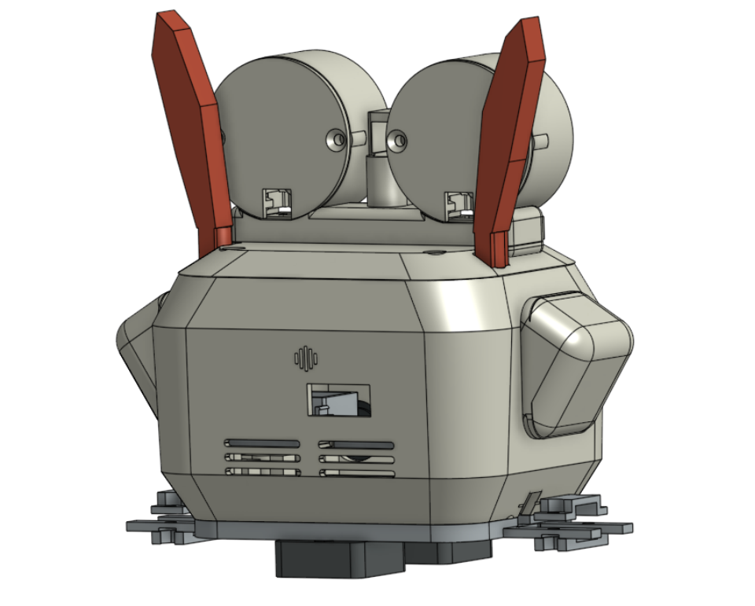
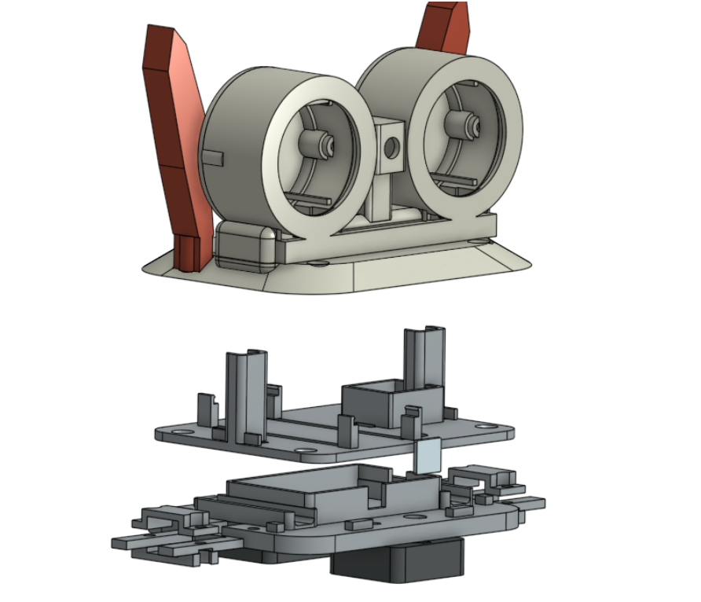
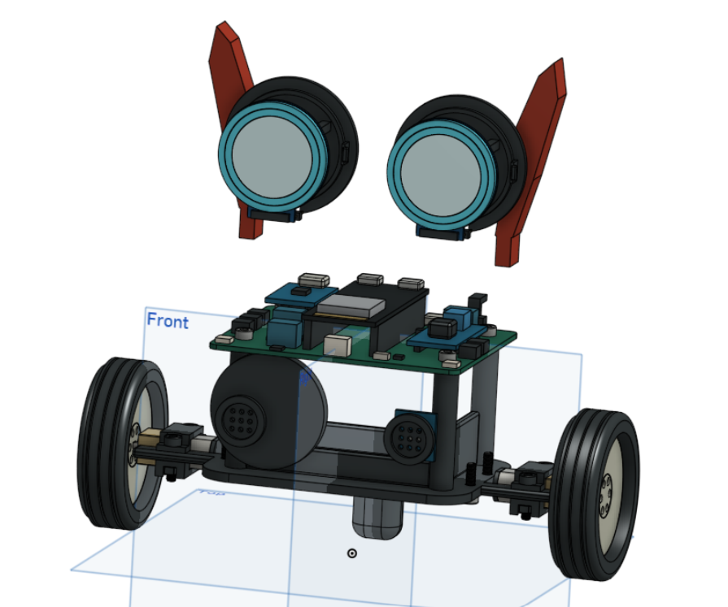
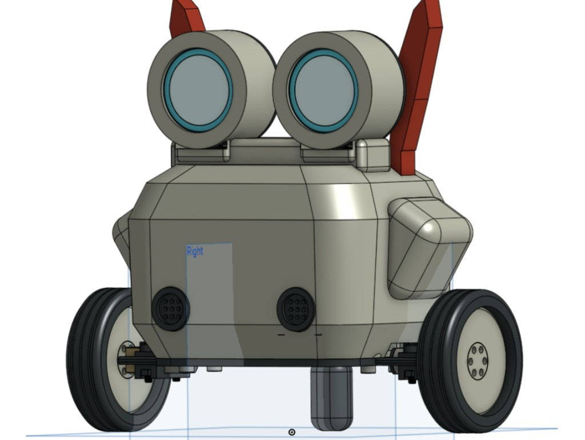

# Astra Companion

Small two-wheeled desk robot with big round eyes, a custom ESP32-S3 carrier PCB, and a PETG chassis. Hack Club **Half Life / OnBoard** project.

| Week | Focus | Grant tier | Parts file |
|------|--------|------------|------------|
| **1** | KiCad carrier + components | ~$103 (Tier 2) | [`hardware/bom.csv`](hardware/bom.csv) |
| **2** | CAD, print, N20 drive | ~$30 (Tier 1) | [`hardware/bom-cad.csv`](hardware/bom-cad.csv) |

---

## CAD (Week 2)

Shell, head, motor plate, and stack-up for the PCB. Full notes: [`docs/CAD.md`](docs/CAD.md).

| Front | Exploded stack |
|-------|----------------|
|  |  |

| PCB in the stack | Wheels + caster |
|------------------|-----------------|
|  |  |

Mechanical BOM (~**$28.60** mixed on the CSV): N20 motors, 43 mm wheels, brackets, 12 mm ball caster, SG90, M3 inserts/screws, PETG (pro-rated). Import **`hardware/bom-cad.csv`** on Half Life for this tier.

---

## PCB (Week 1)

DevKit-based carrier: MPU-6050, DRV8833, power (TP4056 + MT3608 + AP2112K), dual GC9A01, audio and expansion on the schematic.


KiCad project: [`hardware/astracompanion/`](hardware/astracompanion/). Parts import: [`hardware/bom.csv`](hardware/bom.csv). Grant math: [`hardware/BOM_SUMMARY.md`](hardware/BOM_SUMMARY.md).

**Honest status:** placement and routing are still being finished (power nets and DevKit **3V3** tie were open in the last netlist). Do not fab until unrouted = 0 and DRC is clean. Gerbers go in [`hardware/src/`](hardware/src/) after plot.

---

## What the firmware does today

**Balance (Core 0).** MPU-6050 at 200 Hz, complementary tilt, PID into DRV8833. Keeps SPI/Wi-Fi off that core so eye updates do not starve the loop.

**Eyes (Core 1).** Two GC9A01 on one SPI bus; CS on GPIO14/15. States: boot, awake, worried (>35° tilt), sleeping.

**Audio.** INMP441 + MAX98357A wired on the board; streaming not implemented yet.

**Motors default off** until you type `motors on` in the serial monitor (115200). Lift the wheels first.

```bash
cd firmware
pio run -t upload
pio device monitor
```

Pin map: [`docs/PINOUT.md`](docs/PINOUT.md). More detail: [`firmware/README.md`](firmware/README.md).

---

## Repo layout

```text
docs/                 PINOUT, CAD write-up, images
firmware/             PlatformIO / ESP32-S3
hardware/
  astracompanion/     KiCad schematic + PCB
  bom.csv             Week 1 Half Life import
  bom-cad.csv         Week 2 Half Life import
  BOM_SUMMARY.md      PCB tier money notes
  BOM_CAD_SUMMARY.md  CAD tier money notes
  README.md           Which BOM is which
JOURNAL.md            Mirrored from Half Life (edits overwritten on sync)
BOM.md                Mirrored from Half Life (same)
```

---

## Power (carrier)

```text
USB-C / TP4056 → 18650 → MT3608 → +5 V (motors, amp, LEDs)
                              └─ AP2112K → +3.3 V logic
```

Displays run from **+3V3_DISP** through Q4 (GPIO17 enable). Measure rails before seating the DevKit.

---

## Submitting to Half Life

- **Week 2 (now):** `bom-cad.csv`, cart screenshots for mechanical parts, CAD images above (or your Fusion screenshots), log **6 hours** on chassis/CAD/print prep.
- **Week 1 PCB:** `bom.csv`, vendor cart screenshots, Gerbers when routing is done.

Root `JOURNAL.md` / `BOM.md` are copies from the site — update the project on Half Life; sync pulls them back here.
