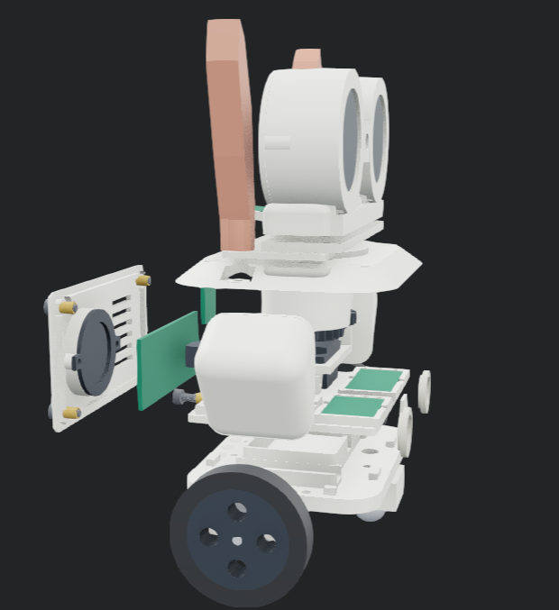
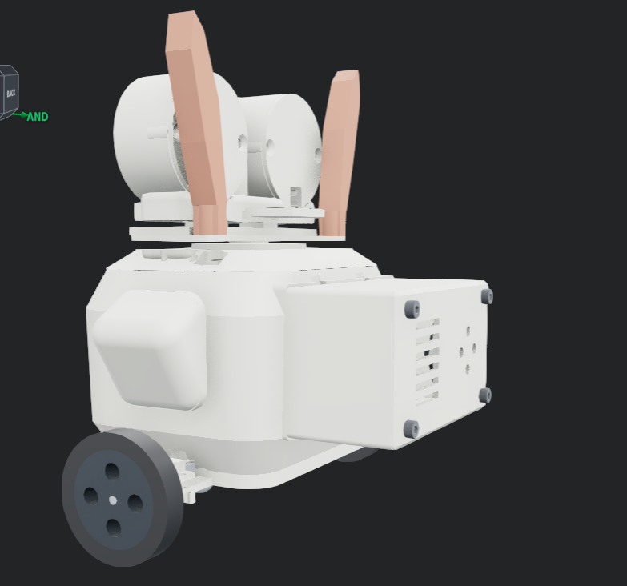
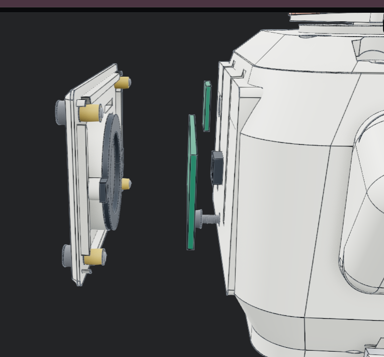

# Audio module and neck pivot (this week)

Mechanical parts for the side speaker box, the neck pivot, and head pan. These fit the printed chassis in [Astra-Companion-Cad](https://github.com/atireksd11/Astra-Companion-Cad). The carrier PCB still has INMP441 and MAX98357A. This week is mostly plastic, bearings, and a stronger servo.

Grant import file: [bom-audio-module.csv](bom-audio-module.csv).

| Part | Qty | Unit | Total | Where |
|------|-----|------|-------|-------|
| PGN 608-ZZ ball bearings (10 pack, 8 by 22 by 7 mm) | 1 pack | $12.95 | $12.95 | Amazon.ca |
| MG90S metal gear micro servo (2 pack) | 1 pack | $14.99 | $14.99 | Amazon.ca |
| Tax and shipping | | | about $5.00 | Prime / domestic |

Parts subtotal is **$27.94** before tax and shipping.

## What each part does

The **608-ZZ bearings** sit at the top and bottom of the neck so the head turns smoothly without grinding on printed plastic.

The **MG90S servos** use metal gears so pan motion does not strip like the old SG90. One servo moves the head left and right. The second from the pack is a spare or a future tilt axis.

## CAD renders

Exploded view of the head, speaker side panel, and neck stack:

Rear view with the vented speaker box on the body:

Inside the torso showing the speaker and board bay:

Side panel, gasket plates, and speaker mount detail:

